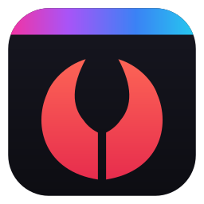
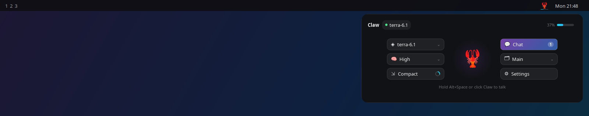
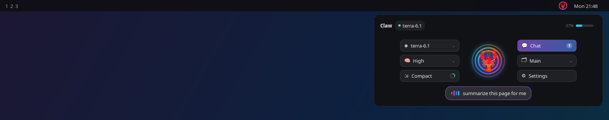
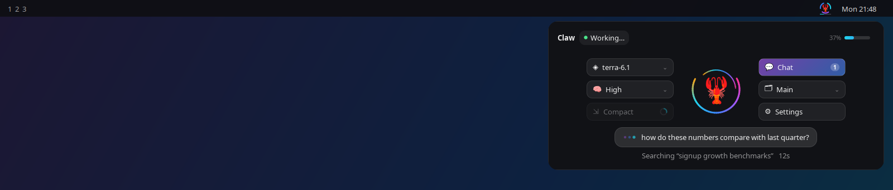
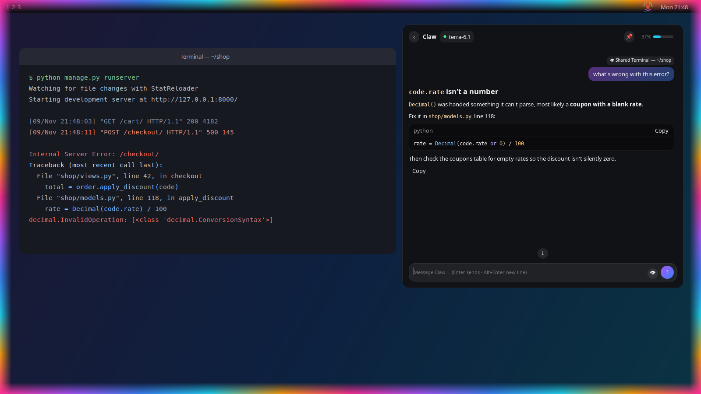
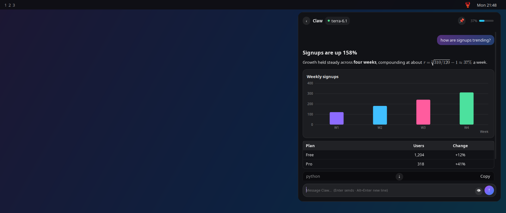
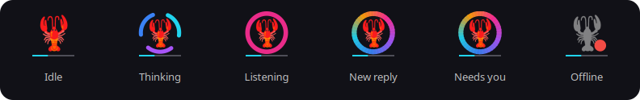

<p align="center">
  
</p>

<h1 align="center">BarClaw</h1>

<p align="center">
  
  
  
  
</p>

<p align="center">
  <b>Talk to your <a href="https://github.com/openclaw/openclaw">OpenClaw</a> agent from the Linux menu bar.</b><br>
  Click the icon to open, hold a key to speak, and watch replies stream in as rich Markdown, LaTeX math, charts, and images.
</p>

<p align="center">
  
</p>

BarClaw is the Linux sibling of [NotchClaw](https://github.com/sjcsoftware/notchclaw). Same agent, same gateway, but it lives in your menu bar instead of the MacBook notch.

## Table of contents

- [Features](#features)
- [Requirements](#requirements)
- [Install](#install)
- [Desktops](#desktops)
- [Set up](#set-up)
- [Use case](#use-case)
- [Charts and images in replies](#charts-and-images-in-replies)
- [Acknowledgments](#acknowledgments)
- [License](#license)

> For more details, check [CONTRIBUTING.md](CONTRIBUTING.md).

## Features

### Hold to talk and control with your voice

<p align="center">
  <br>
  <sub>Hold <kbd>Alt Space</kbd> to speak. Your words appear live.</sub>
</p>

<p align="center">
  <br>
  <sub>The agent's rings orbit while it thinks.</sub>
</p>

- Hold <kbd>Alt Space</kbd> anywhere: the panel opens and your words are transcribed live in a speech bubble. Release to send.
- Speech recognition runs on your computer, on the CPU, with [Vosk](https://alphacephei.com/vosk/). You can plug in your own command instead (whisper.cpp, for example).
- Switch settings by saying: "set effort to high", "switch model to terra 6.1", "compact the context", "new session", or "stop".

### Visual Intelligence

<p align="center">
  <br>
  <sub>The edges glow while BarClaw reads.</sub>
</p>

- Ask about your screen: BarClaw reads it on-device with Tesseract and sends it along with your message.
- Your agent can also look at the screen on its own when a request needs it.

> The 👁 button shows when your screen is shared, and **Settings › Screen** turns it all off.

### Rich replies

<p align="center">
  <br>
  <sub>Replies land in the chat screen as Markdown, math, tables, and charts.</sub>
</p>

### The icon tells you what's going on

<p align="center">
  <br>
  <sub>The icon glows when there's something new.</sub>
</p>

- If your agent uses a ChatGPT/Codex login, the header and icon show your 5-hour or weekly usage (set it in Settings).

### Performance

- It reconnects within moments when the network returns or the computer wakes, and shows a calm offline state in between.
- **Settings › Updates › Check for Updates** installs the newest release from GitHub and restarts BarClaw, keeping your settings.
- Native GTK drawn with Cairo: no browser engine, no GPU work, and a download of about 130 KB.

---

## Requirements

- Linux with GTK 3, libsoup 3, Python 3.10+, and `python3-cryptography`
- A running **OpenClaw gateway** (protocol v4, OpenClaw 2026.8 or newer)
- Optional: `tesseract-ocr` (reading text on screen), PipeWire, PulseAudio or ALSA tools (voice), `gtk-layer-shell` (panel placement on Wayland)

## Install

```bash
curl -fsSL https://raw.githubusercontent.com/sjcsoftware/barclaw/main/install.sh | bash
```

That's it. The script pulls the latest release into your home folder (no root) and picks the right build for your desktop. If GTK or another system package is missing, it shows you the command and asks before running it.

Run the same command again any time to update, or use **Settings › Updates › Check for Updates**.

Prefer to do it by hand? Every version is on the [**Releases**](https://github.com/sjcsoftware/barclaw/releases) page. Download `barclaw-<version>.tar.gz`, unpack it, and run `./install.sh` inside.

### Run from source

```bash
git clone https://github.com/sjcsoftware/barclaw.git
cd barclaw
PYTHONPATH=src python3 -m barclaw
```

## Desktops

| Desktop or bar | What BarClaw uses | Notes |
| --- | --- | --- |
| KDE Plasma, Xfce, Cinnamon, MATE, Budgie, LXQt | StatusNotifierItem | Works out of the box where the panel has a tray applet |
| Waybar, swaybar, Eww | StatusNotifierItem | Enable the bar's tray module |
| i3bar, polybar, tint2 | XEmbed tray | Works out of the box |
| GNOME | Top bar button, or StatusNotifierItem | The installer adds BarClaw's GNOME Shell button from the [`platform/gnome-shell`](https://github.com/sjcsoftware/barclaw/tree/platform/gnome-shell) branch. If the AppIndicator extension is on (as on Ubuntu), it uses that instead |

GNOME Shell has no tray of its own and GTK can't add to its panel, so that one case gets a separate extension. To see what the installer would choose, add `-s -- --detect` after `bash`.

**On Wayland** a few things depend on your compositor:

- *Hold to talk* uses the XDG GlobalShortcuts portal (KDE, GNOME 48+, Hyprland). Elsewhere, bind keys to `barclaw --talk-start` and `barclaw --talk-stop` yourself.
- *Panel placement* uses `gtk-layer-shell` (wlroots compositors and KDE). Without it the compositor picks the position.
- *Screen reading* uses `grim`, `spectacle`, or the screenshot portal.

If no tray is available, BarClaw opens its panel directly. `barclaw --toggle` always works and can be bound to a key.

## Set up

BarClaw opens **Settings** on first launch when it has nothing to connect to. You can reopen it any time with <kbd>Ctrl ,</kbd>, from the gear in the panel, or from the icon's right-click menu.

> The setup is the same as setting up any new machine on your OpenClaw gateway.

1. **Gateway URL**
2. **Token**
3. **Session** - Leave this as `main` to talk to your agent's main session, or enter any session key.
4. Click **Save & Connect**

- **Remote gateways need a one-time approval**

  BarClaw signs in with its own device identity, so the gateway asks you to approve it. The panel shows the exact command; run it on the gateway host:

  ```bash
  openclaw devices list
  openclaw devices approve <requestId>
  ```

  BarClaw connects by itself once you approve it. Connections from the same machine (loopback) are approved automatically.

- **BarClaw node (optional, one-time)**

  So your agent can look at your screen by itself, BarClaw also joins the gateway as a node. If BarClaw has **Admin access**, it approves this itself. Otherwise **Settings › Screen** shows the command to run once on the gateway host. Questions you ask from the panel work without this step.

- **Voice**

  Click **Install speech recognition** in **Settings › Voice**. It downloads the Vosk engine and a small language model (about 50 MB) into BarClaw's own folder. Nothing is installed system-wide.

## Use case

| Do this | To |
| --- | --- |
| Click the menu bar icon | Open the default screen (agent, controls, usage) |
| Hold <kbd>Alt Space</kbd> (or click the agent) | Talk; release to send |
| Click **Chat** | Open the conversation and type (<kbd>Enter</kbd> sends, <kbd>Alt Enter</kbd> adds a new line) |
| Click the model name or **Model** | Switch models (from the gateway's catalog) |
| **Effort** | Set reasoning effort (off → xhigh) |
| **Compact** | Summarize old context; the ring shows how full the context window is |
| **Sessions** | Start a new session, switch to a recent one, or reset the current one (reset needs admin) |
| Click the usage meter | Choose the 5h or weekly Codex window |
| Ask "what's this?", "summarize this page", "translate this" | Share your screen with the question (the 👁 button overrides) |
| <kbd>Esc</kbd> in chat | Clear the draft, or go back home |
| Click another window | Close the panel (the 📌 pin in chat keeps it open) |
| Right-click the icon | Open the menu: chat, talk, settings, updates, quit |

**Voice commands.** Short phrases are treated as controls instead of messages:

| Say | Effect |
| --- | --- |
| "set effort to high", "thinking max" | Reasoning effort |
| "switch model to sonnet", "use gpt five codex model" | Model (fuzzy-matched) |
| "compact the context" | Compaction |
| "new session", "start over" | New session |
| "stop" | Abort the current reply |

Everything else is sent to your agent.

## Charts and images in replies

**Charts need no setup.** Each message sent from BarClaw carries a short formatting note asking the agent to reply in Markdown. When numbers help, the note also asks for a fenced `chart` block, which BarClaw draws itself:

````markdown
```chart
{"type": "bar", "title": "Weekly signups", "x": "Week", "y": "Signups",
 "data": [{"x": "W1", "y": 120}, {"x": "W2", "y": 180}, {"x": "W3", "y": 240, "series": "optional"}]}
```
````

Supported types are `bar`, `line`, `area`, `point`, and `pie`. Add `series` for multiple lines or bars. If the JSON is malformed, the block is shown as code. You can turn the note off in **Settings › Agent**.

**Images use OpenClaw's `image_generate` tool.** It's available whenever an image provider is configured. If your agent signs in with **ChatGPT/Codex OAuth**, `openai/gpt-image-2` already works with no extra keys. Otherwise, set an `OPENAI_API_KEY` (or a Gemini or OpenRouter key) and optionally pick a default model:

```json5
// ~/.openclaw/openclaw.json
{ agents: { defaults: { mediaModels: { image: { primary: "openai/gpt-image-2" } } } } }
```

Generated images appear inline in the chat. Click one to open it, or right-click to copy or save it.

> **Where do standing instructions go?** In OpenClaw, `MEMORY.md` is for durable facts and decisions, not behaviour. If you want charts and images on every channel, add a line to your workspace's **`AGENTS.md`** instead, for example: *"When data is easier to grasp visually, include a chart; when a picture would help, use image_generate."* Inside BarClaw you don't need this, because the per-message note already covers it.

## Acknowledgments

- [OpenClaw](https://github.com/openclaw/openclaw), the personal agent and gateway this app drives.
- [NotchClaw](https://github.com/sjcsoftware/notchclaw), the macOS app BarClaw is modeled on.
- [Vosk](https://alphacephei.com/vosk/) and [Tesseract](https://github.com/tesseract-ocr/tesseract), for on-device speech and OCR.

## License

Copyright © 2026 chaseungjoon.

BarClaw is free software: you can redistribute it and/or modify it under the terms of the
[GNU General Public License v3.0](LICENSE) as published by the Free Software Foundation, either
version 3 of the License, or (at your option) any later version. It is distributed in the hope that it
will be useful, but WITHOUT ANY WARRANTY; see the license for details.
